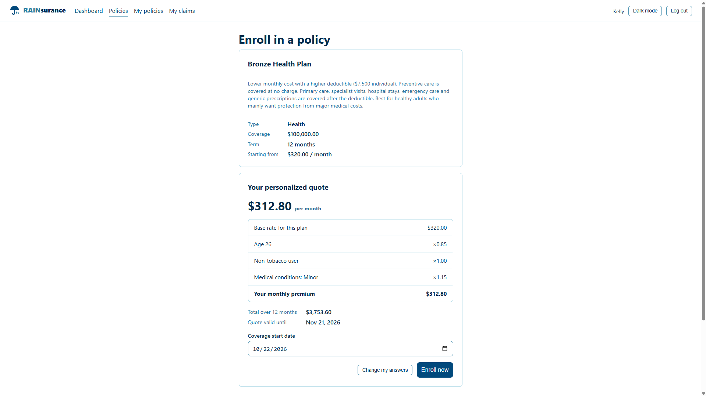
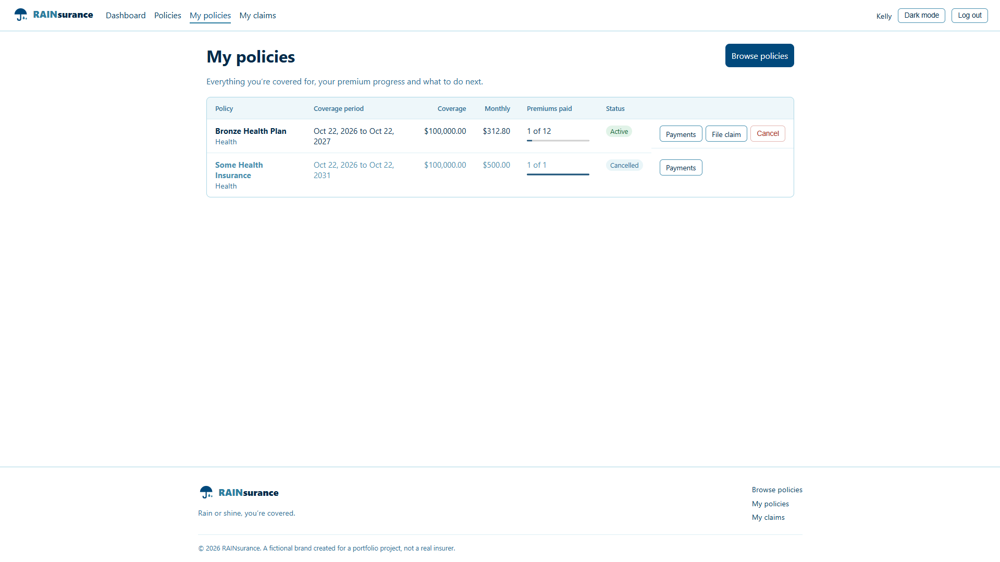
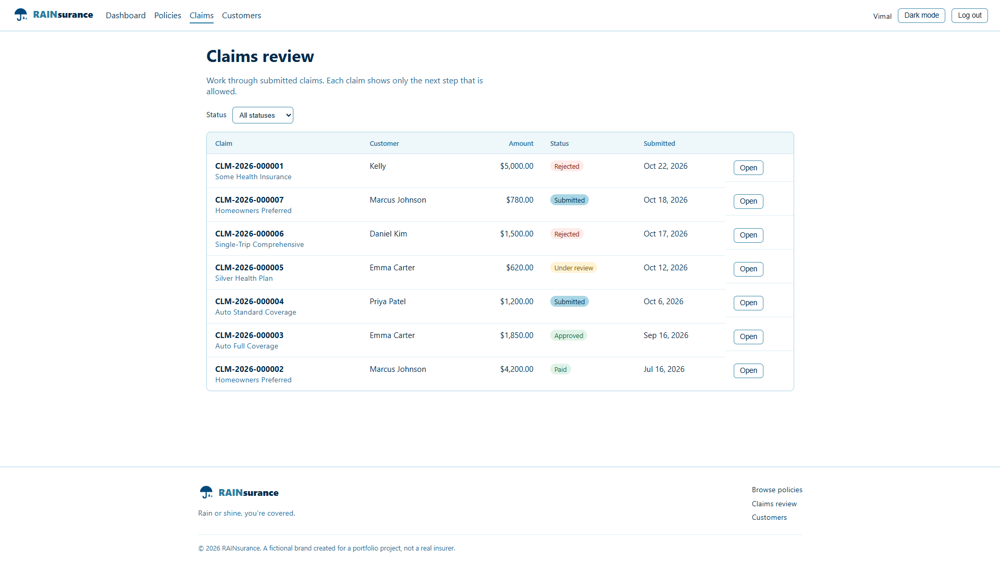
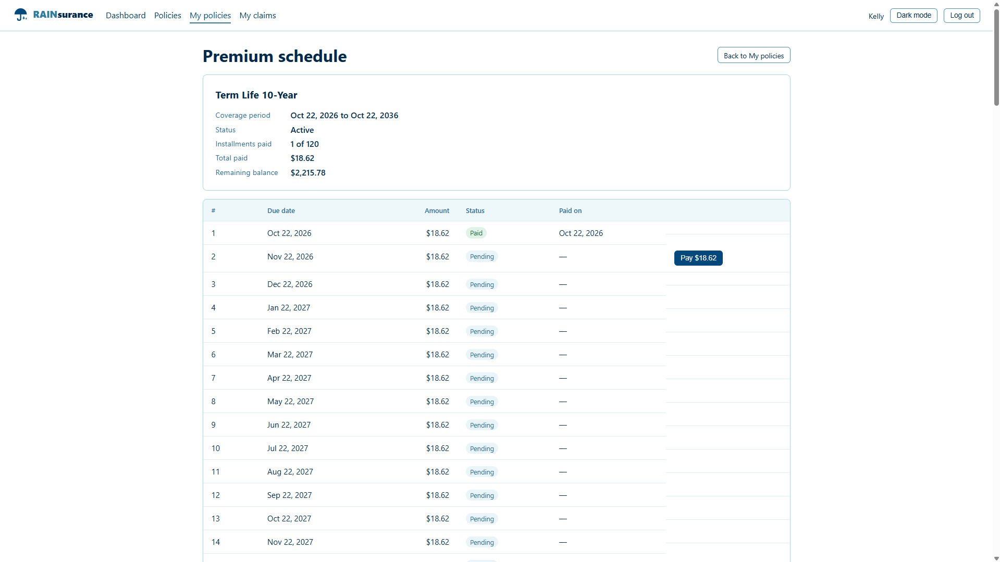
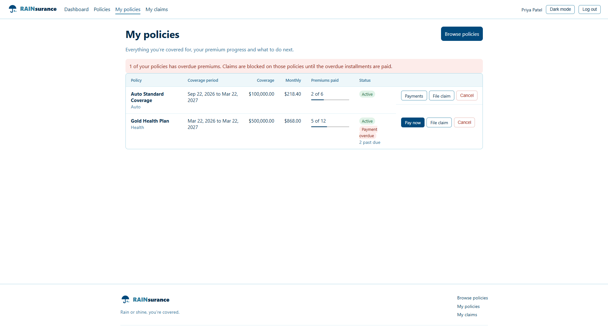
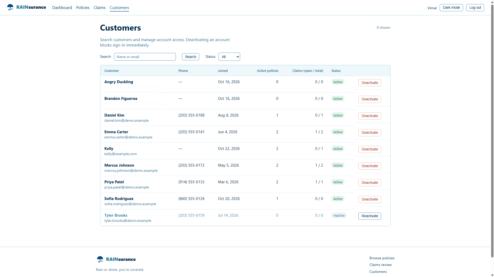
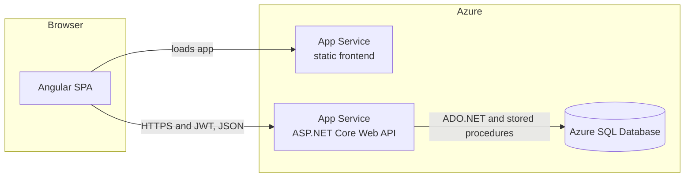
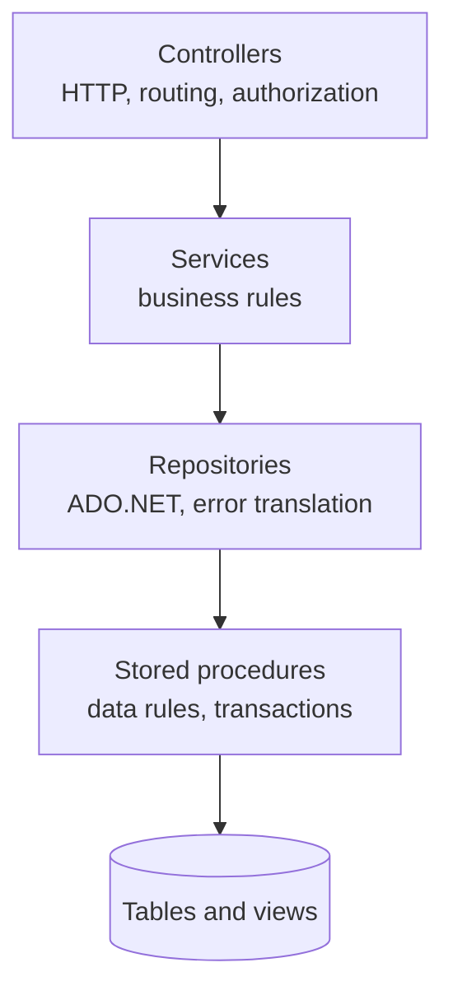

# Online Insurance Management System

A full-stack insurance platform. Customers get **personalized quotes**, enroll in policies, pay monthly premiums and file claims. Administrators manage the plan catalog, review claims and manage customer accounts.


> **Live demo:** [Project Website](https://projectdeploy-ewbahrbra0abcuam.westus3-01.azurewebsites.net/)
> *(Hosted on a development-tier Azure plan, so the first request after a quiet period may take a few seconds.)*
> Demo logins are listed under [Demo accounts](#demo-accounts).

## Screenshots

| Personalized quote | Customer policies | Claims review (admin) |
|---|---|---|
|  |  |  |

| Premium schedule | Overdue alert | Customer management (admin) |
|---|---|---|
|  |  |  |

## Table of contents

- [Overview](#overview)
- [Features](#features)
- [Tech stack](#tech-stack)
- [Architecture at a glance](#architecture-at-a-glance)
- [Key business rules](#key-business-rules)
- [Getting started](#getting-started)
- [Demo accounts](#demo-accounts)
- [Configuration reference](#configuration-reference)
- [API overview](#api-overview)
- [Testing](#testing)
- [Project structure](#project-structure)
- [Deploying to Azure](#deploying-to-azure)
- [Known limitations](#known-limitations)
- [Roadmap](#roadmap)
- [Documentation](#documentation)

## Overview

The application simulates the core operations of an insurer:

1. An admin publishes **plans** (Health, Auto, Life, Home, Travel).
2. A customer answers a short, plan-specific questionnaire. The server **rates** the applicant and issues a **quote**: a price with a full breakdown of how it was calculated, or an underwriting decline.
3. The customer **enrolls** from the quote. One database transaction creates the policy and its monthly **premium schedule**.
4. The customer pays installments, and can **file claims** against active, paid-up policies.
5. Admins move claims through a **review workflow**, and manage customer access.

The backend follows a layered architecture (controllers, services, repositories, stored procedures). All data access uses **ADO.NET with parameterized stored procedures**, and the Angular frontend talks to it through a REST API documented with Swagger.

## Features

### Customers
- Register, sign in and sign out. Passwords are hashed with BCrypt and sessions use JWTs.
- Browse the plan catalog and filter by type.
- **Get a personalized quote:** the API supplies the questions for each plan type, and the form is built dynamically from them. The result shows the base rate, every rating factor, the monthly price, the total over the term and the quote's expiry date.
- Enroll from a quote with a chosen start date, and cancel a policy.
- **Pay premiums** in order from a payment schedule, with paid, pending and overdue states.
- **Payment alerts:** a "payment due soon" or "payment overdue" badge on each policy.
- **File claims** with incident date, amount and description. Eligibility is validated against the policy.
- Track claims through the review workflow and read the reviewer's notes.

### Administrators
- Create, edit and deactivate plans. Deactivated plans disappear for customers but remain on existing policies.
- **Claims review queue** with a status filter. Buttons show only the legal next step, and a rejection requires a reason.
- **Customer management:** search, filter by status, see active-policy and claim counts, and deactivate or reactivate accounts (takes effect on the customer's next request).

### Platform
- Role-based authorization (`Customer`, `Admin`), with ownership checks on every record.
- Centralized error handling that returns consistent RFC 7807 `ProblemDetails` responses.
- Swagger/OpenAPI with JWT support for testing the API.
- Seed scripts for a 20-plan catalog and a set of demo customers with realistic histories.

## Tech stack

| Layer | Technology |
|---|---|
| Frontend | Angular (standalone components, signals, lazy-loaded routes), TypeScript, HTML5, CSS3, RxJS |
| API | C#, ASP.NET Core Web API, RESTful design, Swagger/OpenAPI (Swashbuckle) |
| Data access | ADO.NET (`Microsoft.Data.SqlClient`), parameterized stored procedures, views, LINQ in the service layer |
| Database | SQL Server / Azure SQL Database (relational design, constraints, transactions, a sequence) |
| Security | JWT bearer authentication, BCrypt, role-based authorization |
| Patterns | Dependency injection, layered architecture, repository, strategy (rating engine), DTOs |
| Testing | xUnit with hand-written fakes |
| Hosting | Azure App Service (API and frontend), Azure SQL Database |
| Tooling | Visual Studio Code, Git and GitHub |

## Architecture at a glance



Inside the API, a request flows one way:



Each layer only knows the one below it, through interfaces registered with dependency injection. See [docs/ARCHITECTURE.md](docs/ARCHITECTURE.md) for sequence diagrams, the ER diagram, the claim workflow, the rating engine, the security model and the complete error-number registry.

## Key business rules

| Area | Rule |
|---|---|
| Quotes | Priced on the server from the customer's answers. The client never sends a price. Valid for 30 days and usable once. |
| Rating | `premium = base rate x every factor`, rounded to cents, minimum $1.00. Some answers trigger an underwriting decline. |
| Enrollment | Start date from yesterday (time-zone slack) to 90 days ahead. One active enrollment per plan per customer. The premium is copied from the quote, so later plan price changes never alter existing policies. |
| Payments | Installments must be paid **in order**. An unpaid installment becomes **Overdue** more than **5 days** past its due date. A payment alert shows when the next due date is within **7 days**. |
| Claims | Active policy only. The incident must fall inside the coverage period and not be in the future. No overdue premiums. The amount cannot exceed the remaining coverage (policy coverage minus approved and paid claims). |
| Claim workflow | Submitted, Under review, then Approved or Rejected, then (approved only) Paid. A rejection needs a reason. Concurrent edits are detected. |
| Accounts | Deactivated accounts cannot sign in and existing tokens stop working. Admin accounts cannot be deactivated from the UI. |

## Getting started

### Prerequisites

- [.NET SDK](https://dotnet.microsoft.com/download) (current LTS)
- [Node.js](https://nodejs.org/) 20 or later, and the Angular CLI (`npm install -g @angular/cli`)
- SQL Server (any edition), **or** Azure SQL Database, **or** Docker:
```bash
  docker run -e ACCEPT_EULA=Y -e "MSSQL_SA_PASSWORD=YourStrong!Passw0rd" -p 1433:1433 -d mcr.microsoft.com/mssql/server:2022-latest
```
- Recommended VS Code extensions: C# Dev Kit, SQL Server (mssql), Angular Language Service

### 1. Clone

```bash
git clone https://github.com/<your-username>/insurance-management-system.git
cd insurance-management-system
```

### 2. Create the database

Run the scripts in `database/` **in numeric order** (VS Code with the mssql extension, SSMS, Azure Data Studio or `sqlcmd` all work).

| Script | Purpose |
|---|---|
| `01_schema.sql` | Add your own CREATE `DatabaseName` at the top, constraints and indexes |
| `02_stored_procedures.sql` | User and policy procedures |
| `03_enrollments.sql` | Enrollment view and procedures |
| `04_payments.sql` | Payment view and procedures |
| `05_claims.sql` | Claim number sequence, view and procedures |
| `06_grace_period.sql` | 5-day overdue grace period |
| `07_payment_alerts.sql` | Overdue count and next-due fields on the enrollment view |
| `08_admin_customers.sql` | Customer summary view and procedures |
| `09_quotes.sql` | Quotes table and procedures, and the quote-based enrollment procedure |
| `10_seed_policies.sql` | 20 plans: four variants for each policy type |
| `11_seed_demo_data.sql` | *Optional:* demo customers, enrollments, payments and claims |
| `12_remove_demo_data.sql` | *Optional:* removes the demo data |

### 3. Configure and run the API

```bash
cd InsuranceApi
dotnet restore
dotnet user-secrets init
dotnet user-secrets set "Jwt:Key" "replace-with-at-least-32-random-characters"
# Only if your connection string differs from appsettings.json:
dotnet user-secrets set "ConnectionStrings:InsuranceDb" "Server=localhost;Database=InsuranceDb;Trusted_Connection=True;TrustServerCertificate=True;"
dotnet run --urls http://localhost:5080
```

Swagger UI: <http://localhost:5080/swagger> (available in the Development environment). Register a user with `POST /api/auth/register`, copy the token, click **Authorize** and paste it.

For SQL Server in Docker, use this connection string:
`Server=localhost,1433;Database=InsuranceDb;User Id=sa;Password=YourStrong!Passw0rd;TrustServerCertificate=True;`

### 4. Run the frontend

```bash
cd insurance-web
npm install
ng serve
```

Open <http://localhost:4200>. The API address is set in `src/app/core/api.config.ts` (`http://localhost:5080/api` by default).

### 5. Create the admin account

There is intentionally no public admin sign-up. Register a normal account in the app, then promote it:

```sql
UPDATE dbo.Users SET Role = 'Admin' WHERE Email = 'you@example.com';
```

Sign in again so the new role is placed in your token.

## Demo accounts

After running `11_seed_demo_data.sql`, every demo customer signs in with the password **`Demo#2026pass`**.

| Customer | Email | What to look at |
|---|---|---|
| Emma Carter | `emma.carter@demo.example` | Fully paid up. Claims in **Approved** and **Under review**. |
| Marcus Johnson | `marcus.johnson@demo.example` | Home and Life policies. Claims in **Paid** and **Submitted**. |
| Priya Patel | `priya.patel@demo.example` | **Overdue premiums** (red alert, claims blocked on that policy). |
| Daniel Kim | `daniel.kim@demo.example` | Travel policies, a **Rejected** claim with the reviewer's reason, and an **Expired** policy. |
| Sofia Rodriguez | `sofia.rodriguez@demo.example` | New customer with a **payment due today** alert and no claims. |
| Tyler Brooks | `tyler.brooks@demo.example` | **Inactive** account (sign-in is refused) with a cancelled policy. |

The admin account is the one you promoted in step 5. These credentials exist for the development environment only.

## Configuration reference

| Setting | Where | Notes |
|---|---|---|
| `ConnectionStrings:InsuranceDb` | `appsettings.json`, user secrets, or App Service setting `ConnectionStrings__InsuranceDb` | SQL Server or Azure SQL connection string |
| `Jwt:Key` | **User secrets or App Service setting only. Never commit it.** | At least 32 characters |
| `Jwt:Issuer`, `Jwt:Audience` | `appsettings.json` | Must match between token creation and validation |
| `Jwt:ExpiryMinutes` | `appsettings.json` | Default 60 |
| `Cors:AllowedOrigins` | `appsettings.json` (array) or `Cors__AllowedOrigins__0` | Frontend origins allowed to call the API |
| `API_URL` | `InsuranceApi`-facing constant in `src/app/core/api.config.ts` | Frontend's API base address |

## API overview

Interactive documentation is in Swagger. Statuses follow REST conventions: `201` on create, `204` on updates with no body, `400` validation or business rule, `401` not signed in, `403` wrong role, `404` not found **or not yours**, `409` state conflict.

| Area | Endpoint | Access |
|---|---|---|
| **Auth** | `POST /api/auth/register` | Public |
| | `POST /api/auth/login` | Public |
| | `GET /api/auth/me` | Signed in |
| **Policies** | `GET /api/policies` | Signed in (`?includeInactive=true` for admins) |
| | `GET /api/policies/{id}` | Signed in |
| | `POST /api/policies`, `PUT /api/policies/{id}`, `DELETE /api/policies/{id}` | Admin (delete is a soft delete) |
| **Quotes** | `GET /api/quotes/questions/{policyId}` | Customer |
| | `POST /api/quotes` | Customer |
| | `GET /api/quotes/{id}` | Customer (owner) |
| **Enrollments** | `GET /api/enrollments/mine` | Signed in (own records) |
| | `GET /api/enrollments/{id}` | Owner or admin |
| | `POST /api/enrollments` | Customer |
| | `PUT /api/enrollments/{id}/cancel` | Owner |
| **Payments** | `GET /api/enrollments/{id}/payments` | Owner or admin |
| | `POST /api/payments/{id}/pay` | Customer (owner) |
| **Claims** | `POST /api/claims` | Customer |
| | `GET /api/claims/mine` | Customer |
| | `GET /api/claims?status=` | Admin |
| | `GET /api/claims/{id}` | Owner or admin |
| | `PUT /api/claims/{id}/review` | Admin |
| **Customers** | `GET /api/admin/customers?search=&isActive=` | Admin |
| | `PUT /api/admin/customers/{id}/active` | Admin |

## Testing

Unit tests cover the business logic with in-memory fakes, so no database is needed:

```bash
dotnet test InsuranceApi.Tests
```

| Test class | Covers |
|---|---|
| `RatingStrategyTests` | Prices for every policy type, underwriting declines, answer validation |
| `ClaimStatusTransitionsTests` | Every allowed and blocked workflow move |
| `AuthServiceTests` | Password hashing, email normalizing, role forcing, inactive users |
| `EnrollmentServiceTests` | Start-date window, payment alert thresholds, ownership, cancellation |
| `ClaimServiceTests` | Review rules, the concurrency guard, claim visibility |

The data layer (stored procedures and repositories) is verified through Swagger and the demo data rather than automated integration tests.

## Project structure

```
insurance-management-system/
├── database/                  SQL scripts 01-12 (schema, procedures, views, seed data)
├── InsuranceApi/              ASP.NET Core Web API
│   ├── Controllers/           HTTP layer: routing, authorization, status codes
│   ├── Services/              Business rules (auth, quotes, enrollments, payments, claims, customers)
│   ├── Repositories/          ADO.NET data access, one per aggregate
│   ├── Rating/                Rating engine: strategies per policy type, answer validation
│   ├── Models/                Domain and read models
│   ├── DTOs/                  Request and response shapes for the API
│   ├── Enums/                 UserRole, PolicyType, statuses, PaymentAlert
│   ├── Exceptions/            Typed exceptions and the central ApiExceptionHandler
│   └── Data/                  Connection factory and ADO.NET helpers
├── InsuranceApi.Tests/        xUnit tests and in-memory fakes
├── insurance-web/             Angular client
│   └── src/app/
│       ├── core/              Services, models, guards, interceptor, utilities
│       ├── features/          auth, dashboard, policies, enrollments, payments, claims, customers
│       └── layout/            App shell and navigation
└── docs/                      Architecture document and screenshots
```

## Deploying to Azure

The API and the Angular build each run on an Azure App Service, with an Azure SQL Database behind the API.

1. Run the SQL scripts against the Azure SQL database (remove the `USE` line).
2. Set these **Application settings** on the API's App Service (these override `appsettings.json`):

   | Name | Value |
   |---|---|
   | `ConnectionStrings__InsuranceDb` | Azure SQL connection string |
   | `Jwt__Key` | A long random secret |
   | `Jwt__Issuer`, `Jwt__Audience` | Same as in `appsettings.json` |
   | `Cors__AllowedOrigins__0` | The deployed frontend's origin, with no trailing slash |

3. Point `API_URL` in `src/app/core/api.config.ts` at the deployed API, then run `ng build` and deploy the output.
4. Angular's client-side routes need a fallback to `index.html` on the web host.
5. Allow the App Service to reach the SQL server in the Azure SQL firewall settings.

Swagger is enabled only in the Development environment. Set `ASPNETCORE_ENVIRONMENT=Development` on the App Service only if you want it exposed on the hosted copy.

## Known limitations

- **Simulated payments.** There is no payment gateway. "Pay" records a payment. Cancelling a policy removes its unpaid installments instead of voiding them.
- **Illustrative pricing.** Rating multipliers are hard-coded in the strategy classes. They are not actuarial data and cannot be edited from the UI.
- **UTC date rules.** "Today" is evaluated in UTC, with slack in the enrollment window and a grace period on overdue premiums to cover time-zone differences.
- **Token storage.** The JWT is kept in `localStorage` with no refresh-token flow. Production systems often use httpOnly cookies.
- **Per-request account check.** The API checks that the account is active and the role unchanged on every request. This is simple and immediate, but adds one small database lookup per call.
- **No pagination, file attachments or notifications** (email or push) yet.
- **Test scope.** Business logic is unit-tested. There are no frontend or database integration tests.
- **Single admin role** with no admin-management screen. Admins are promoted by SQL.

## Roadmap

- Admin-editable rating factors stored in the database
- Pagination and sorting on the large lists
- A "My quotes" screen and admin dashboard statistics
- Claim attachments and email notifications
- Refresh tokens or httpOnly cookie sessions
- Integration tests against a real database, and a GitHub Actions CI pipeline

## Documentation

- [Architecture document](docs/ARCHITECTURE.md): diagrams, data model, workflows, rating engine, security, **error-number registry**
- Swagger UI at `/swagger` for the live API reference

## Author

Built by Vimal Ramnarain as a full-stack portfolio project. [GitHub](https://github.com/<your-username>) · [LinkedIn](https://www.linkedin.com/in/YOUR-PROFILE)
