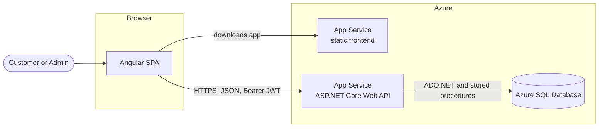
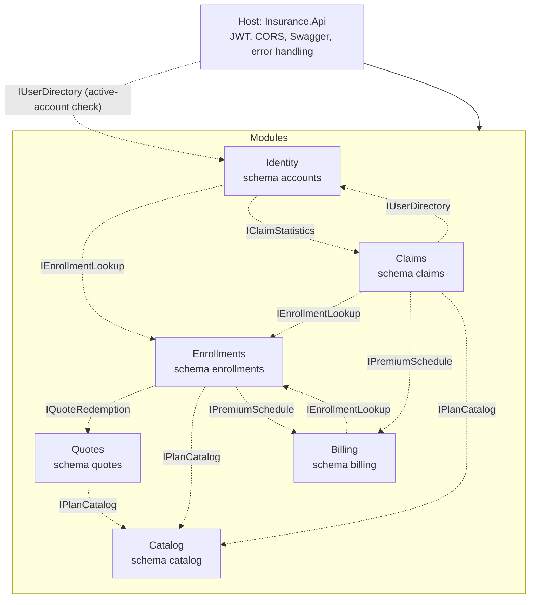
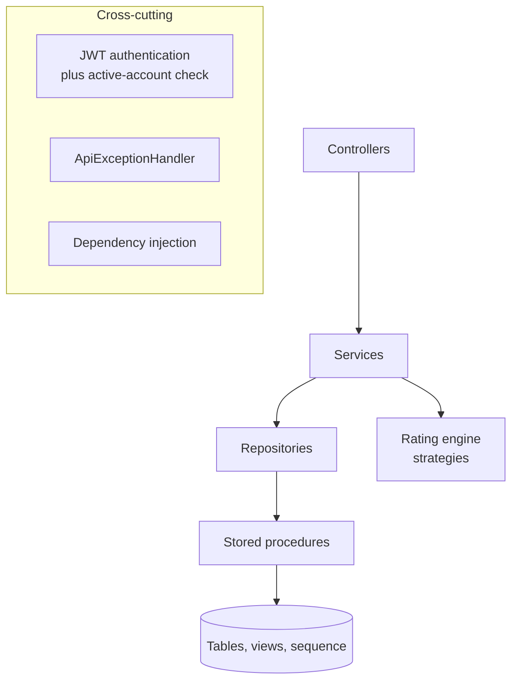
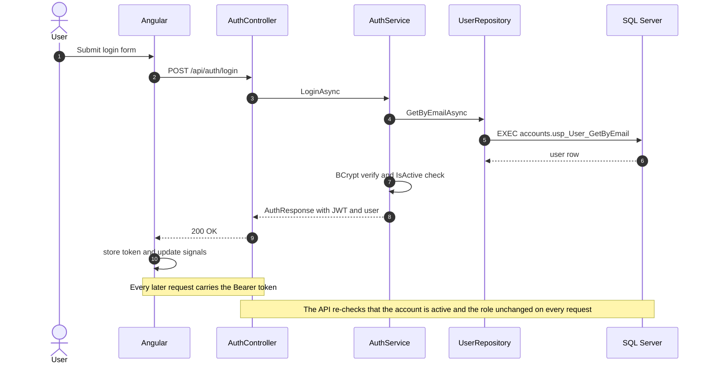
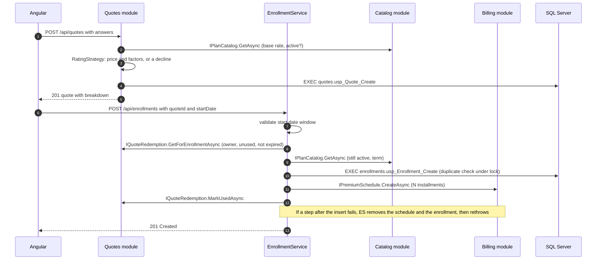
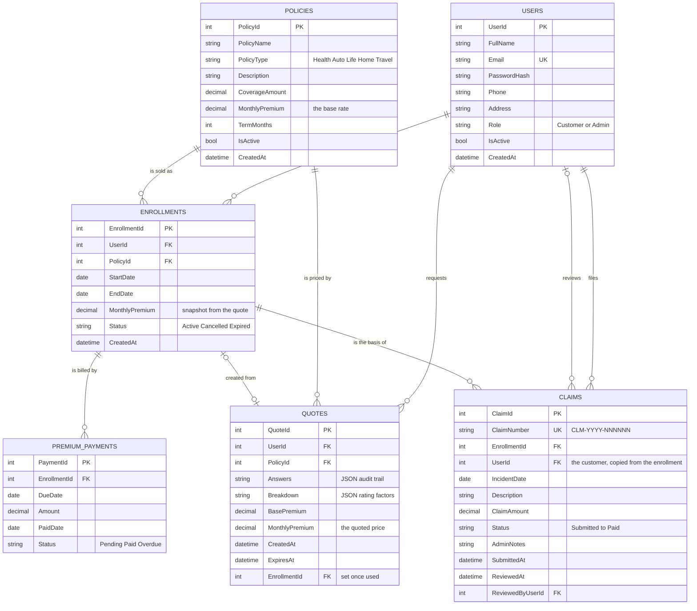
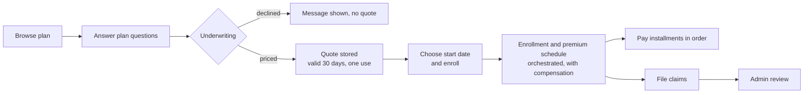
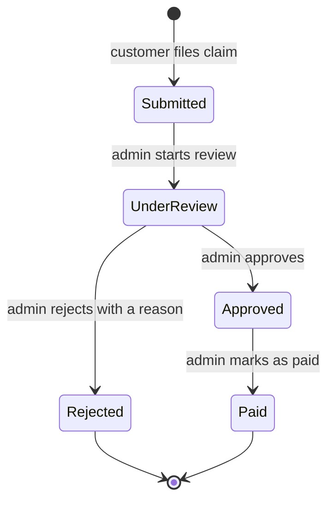
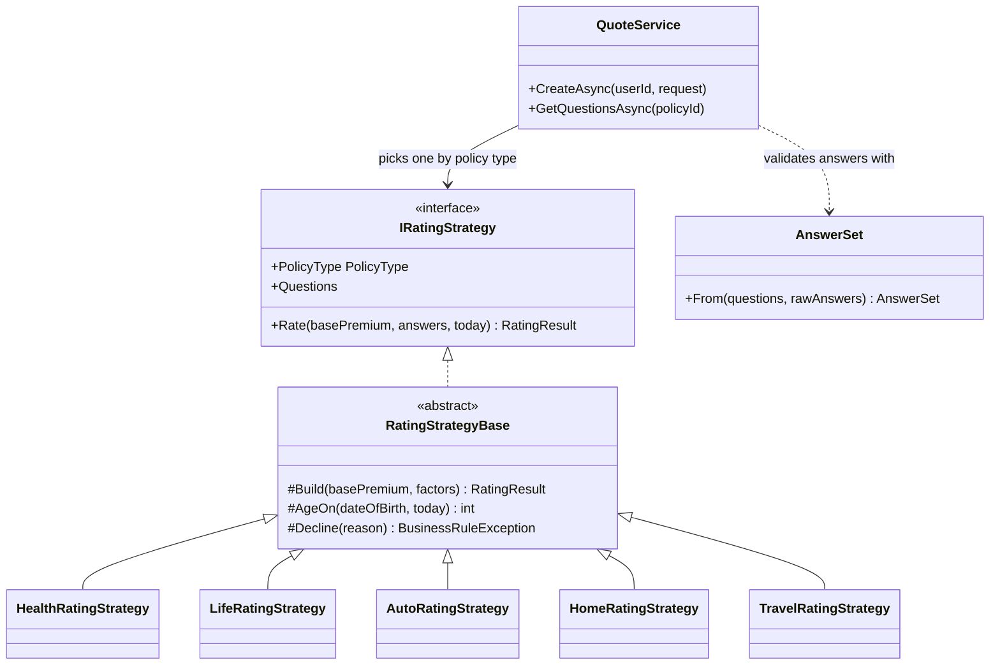
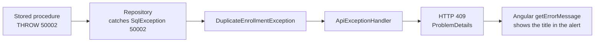

# Architecture

This document explains how the Online Insurance Management System is built and why. For setup and usage, see the [README](../README.md).

## Contents

1. [Goals and principles](#1-goals-and-principles)
2. [System context](#2-system-context)
3. [Backend layers](#3-backend-layers)
4. [Request flows](#4-request-flows)
5. [Data model](#5-data-model)
6. [Domain workflows](#6-domain-workflows)
7. [Rating engine](#7-rating-engine)
8. [Security](#8-security)
9. [Error handling and the error-number registry](#9-error-handling-and-the-error-number-registry)
10. [Database object catalog](#10-database-object-catalog)
11. [Transactions and concurrency](#11-transactions-and-concurrency)
12. [Frontend architecture](#12-frontend-architecture)
13. [Conventions](#13-conventions)
14. [Design decisions and trade-offs](#14-design-decisions-and-trade-offs)
15. [Testing strategy](#15-testing-strategy)
16. [Limitations and future work](#16-limitations-and-future-work)

---

## 1. Goals and principles

| Principle | How it shows up |
|---|---|
| **The server owns the truth** | Prices, eligibility and workflow rules are decided in the API and database. The Angular app displays results (including alerts and allowed next actions) and never recomputes them. |
| **Separation of concerns** | Controllers handle HTTP, services hold business rules, repositories hold data access, stored procedures hold data rules and transactions. |
| **Dependency inversion** | Layers depend on interfaces. Each module's `Add<Module>Module()` is the only place that chooses its concrete classes. This also makes the services unit-testable with fakes. |
| **Module boundaries** | Six modules, each its own project and database schema, talk to each other only through `*.Contracts` interfaces. Each one can later be extracted into its own service. |
| **Fail safely and consistently** | Typed exceptions flow to one handler that returns `ProblemDetails` with the right status code. |
| **Least privilege** | Every endpoint declares its roles, and record ownership is checked on top of roles. |
| **One source of truth per rule** | The overdue rule lives in one SQL view, the workflow in one C# class, the due-soon window in one constant. |

## 2. System context



The frontend is a single-page application served as static files. All business operations go through the REST API. The database is only ever reached by the API.

## 3. Backend modules and layers

The API is a **modular monolith**: one deployable host (`src/Host/Insurance.Api`) made of six modules. Each module is the seed of a future microservice. It owns its controllers, services, repositories, and its own SQL schema with that schema's tables, views and procedures.



| Rule | Enforced by |
|---|---|
| A module references only `Insurance.BuildingBlocks` and other modules' `*.Contracts` projects | Project references, plus `Insurance.Architecture.Tests` (fails the build otherwise) |
| A module's procedures and views read and write only its own schema | Code review. `sys.sql_expression_dependencies` lists no cross-schema reference |
| No foreign keys between schemas | `11_module_schemas.sql` drops them. Integrity across modules is kept by the API |

Data another module owns is fetched through its contract, in **one batched call per module per request** (for example `GetManyAsync(ids)`), never by a SQL join.

Inside each module, a request flows through the same layers as before:



| Layer | Responsibility | Must not |
|---|---|---|
| **Controllers** | Routing, role attributes, reading the caller's id from the token, choosing success status codes | Contain business rules or SQL |
| **Services** | Business rules (date windows, workflow transitions, rating, ownership decisions), composing data from other modules' contracts, mapping models to DTOs | Know about HTTP or SQL, or use another module's repository |
| **Repositories** | ADO.NET calls to stored procedures, mapping rows to models, translating SQL error numbers into typed exceptions | Contain business decisions |
| **Stored procedures** | Data rules that must be atomic, transactions, locking, ownership filters | Hash passwords, build tokens, know about HTTP, touch another module's schema |
| **Rating engine** | Pure functions from answers to a price or a decline | Touch the database |

**Why stored procedures:** they give a clear contract between the app and the database, remove SQL injection from the picture (the C# code never builds SQL strings), and keep each module's multi-step operations (paying, filing and reviewing a claim) atomic.

**Dependency injection lifetimes**

| Lifetime | Registered types | Reason |
|---|---|---|
| Singleton | `IDbConnectionFactory`, all `IRatingStrategy` implementations | Stateless. Connections are created per operation and pooled by ADO.NET |
| Scoped | Repositories, services, contract implementations, token service | One per HTTP request |

## 4. Request flows

### 4.1 Sign-in and token use



### 4.2 Quote and enrollment



Enrolling used to be one SQL transaction across four tables. Those tables now belong to four modules, so it runs as an **orchestrated sequence with compensation**: each step commits in its own module, and a failure after the enrollment row exists undoes the earlier steps. This is the in-process form of the enrollment saga that a message bus will run once the modules are separate services.

## 5. Data model



> In the database the payments table is named `PremiumPayments`. It is written with an underscore in the diagram only because Mermaid requires it.

**Schemas.** Each table lives in its module's schema: `accounts.Users`, `catalog.Policies`, `quotes.Quotes`, `enrollments.Enrollments`, `billing.PremiumPayments`, `claims.Claims` (and `claims.ClaimNumberSeq`). The relationships in the diagram are logical: the columns hold the other module's id, but **there are no foreign keys between schemas**, because once each module has its own database the database could not enforce them anyway. The API keeps them consistent.

**Design notes**

- **Premium snapshot.** `Enrollments.MonthlyPremium` is copied from the quote. Changing a plan's base rate later never changes existing policies.
- **Soft deletes.** Plans and customers are deactivated (`IsActive = 0`), never deleted, because enrollments and claims reference them. This is also what makes cross-module lookups safe without foreign keys.
- **Claims carry their customer.** `Claims.UserId` is copied from the enrollment when the claim is filed, so "my claims" is answered inside the claims schema.
- **Derived statuses.** `Expired` (an enrollment past its end date) and `Overdue` (a payment more than 5 days late) are computed in views at read time, so no background job has to keep a column in sync.
- **Constraints as a backstop.** `CHECK` constraints mirror each C# enum (roles, plan types, statuses), and `UNIQUE` constraints protect emails and claim numbers.
- **Quotes keep an audit trail.** The raw answers and the factor breakdown are stored as JSON (guarded by `ISJSON` checks), so any price can be explained later.
- **Claim numbers** come from a database `SEQUENCE` (`claims.ClaimNumberSeq`), formatted `CLM-<year>-<6 digits>`. A rolled-back insert can leave a gap, which is normal.

## 6. Domain workflows

### 6.1 From plan to policy



### 6.2 Claim workflow



The allowed moves live in **one** place, the `ClaimStatusTransitions` class. The API returns `allowedNextStatuses` on each claim for admins, so the UI shows only legal buttons and holds no copy of the rules. `usp_Claim_Review` takes the status the caller *believes* the claim is in (`@FromStatus`) and only updates if it still matches. This is optimistic concurrency: two admins acting on the same claim cannot silently overwrite each other, and the loser receives a `409`.

**Claim eligibility.** Rules 1 to 4 need other modules' data, so `ClaimService` checks them through their contracts. Rule 5 needs a lock on this module's own rows, so it stays in `claims.usp_Claim_Submit`:

1. The enrollment belongs to the caller (`IEnrollmentLookup`).
2. It is active and has not ended (`IEnrollmentLookup`, derived status).
3. The incident date is inside the coverage period and not in the future.
4. No installment is overdue (`IPremiumSchedule`, read from `billing.vw_PaymentDetails`, the same source as the Overdue badge).
5. The amount does not exceed the remaining coverage: the plan's coverage (`IPlanCatalog`) minus approved and paid claims. Approval re-checks this, so two claims cannot together exceed it.

### 6.3 Derived statuses and alerts

| Concept | Rule | Where it lives |
|---|---|---|
| Enrollment **Expired** | Stored `Active` and `EndDate` is before today (UTC) | `enrollments.vw_EnrollmentDetails` |
| Payment **Overdue** | Stored `Pending` and due more than **5 days** ago | `billing.vw_PaymentDetails` |
| Alert **Overdue** | Active enrollment with at least one overdue payment | `billing.usp_Premium_GetSummaries` (count) and `EnrollmentService` |
| Alert **DueSoon** | Active, nothing overdue, next unpaid installment due within **7 days** | `EnrollmentService` (`DueSoonDays` constant) |
| Alert **None** | Anything else, including cancelled policies | `EnrollmentService` |

## 7. Rating engine

Pricing is rule-based. Each plan type has its own strategy, and all share one contract.



**How a quote is produced**

1. `QuoteService` receives every registered `IRatingStrategy` through DI and indexes them by `PolicyType`. Adding a new plan type means adding one strategy class and one registration.
2. `AnswerSet.From` validates the raw JSON answers against the strategy's `QuestionDefinition` list (type, range, allowed options), so strategies read typed values without re-checking.
3. The plan's `MonthlyPremium` is treated as the **base rate**. `Rate` multiplies it by each factor, rounds to cents (away from zero) and enforces a $1.00 minimum.
4. A decline is a `BusinessRuleException`, which becomes a `400` with the reason.
5. The result, the answers and the factor breakdown are stored in `Quotes`. Enrollment later reads the stored price, so a client can never choose its own.

**Server-driven questionnaire.** `GET /api/quotes/questions/{policyId}` returns the strategy's questions. Angular builds its reactive form from that list, including validators. A new question added in C# appears in the UI with no frontend change.

### Rating factors

> These multipliers are illustrative demo values, not actuarial data.

| Plan type | Factor | Values (multiplier) | Decline |
|---|---|---|---|
| **Health** | Age | under 30: 0.85 · 30-44: 1.00 · 45-59: 1.35 · 60+: 1.80 | under 18 |
| | Tobacco | yes: 1.40 · no: 1.00 | |
| | Conditions | None: 1.00 · Minor: 1.15 · Major: 1.45 | |
| **Life** | Age | under 30: 0.70 · 30-44: 1.00 · 45-59: 2.00 · 60-69: 3.50 | under 18, or 70+ |
| | Tobacco | yes: 1.90 · no: 1.00 | |
| | Conditions | None: 1.00 · Minor: 1.25 · Major: 1.80 | |
| **Auto** | Driver age | under 25: 1.60 · 25-64: 1.00 · 65+: 1.20 | under 18 |
| | Vehicle age | up to 3 years: 1.15 · 4-10: 1.00 · over 10: 0.90 | |
| | At-fault accidents (5 yrs) | 0: 1.00 · 1: 1.30 · 2: 1.70 · 3: 2.20 | 4 or more |
| | Annual mileage | under 7,500: 0.90 · 7,500-15,000: 1.00 · over 15,000: 1.20 | |
| **Home** | Home age | up to 10 years: 0.95 · 11-30: 1.00 · 31-60: 1.15 · over 60: 1.35 | |
| | Monitored security | yes: 0.90 · no: 1.00 | |
| | Claims (5 yrs) | 0: 1.00 · 1: 1.20 · 2: 1.50 | 3 or more |
| **Travel** | Traveler age | under 30: 0.90 · 30-59: 1.00 · 60+: 1.40 | under 18 |
| | Trip length | up to 14 days: 1.00 · 15-30: 1.25 · over 30: 1.60 | |
| | Destination | Domestic: 1.00 · International: 1.45 | |

**Worked example (Auto, base $120):** driver aged 22 (x1.60), 2020 vehicle (x1.00), one at-fault accident (x1.30), mid mileage (x1.00). 120 x 1.60 x 1.30 = **$249.60 / month**.

## 8. Security

### Authentication

- Passwords are hashed with **BCrypt** (salted, with an adaptive work factor) in `AuthService`. Only the hash is stored.
- Sign-in issues an HS256-signed **JWT** carrying the user id, email, name and role. It expires after `Jwt:ExpiryMinutes` (60 by default), with a one-minute clock skew.
- Login returns the same `401` for an unknown email, a wrong password and a deactivated account, so attackers cannot discover which emails exist.
- **Active-account check on every request.** Besides validating the signature, the JWT handler's `OnTokenValidated` event loads the user and rejects the token if the account is missing, deactivated, or its role has changed. Deactivation therefore takes effect immediately, not when the token expires.

### Authorization

Roles are enforced with `[Authorize(Roles = ...)]`, and **ownership is enforced separately** in services and procedures. Using someone else's record returns `404`, not `403`, so ids cannot be probed.

| Capability | Anonymous | Customer | Admin |
|---|:---:|:---:|:---:|
| Register, sign in | yes | | |
| Browse plans | | yes | yes |
| Create, edit, deactivate plans | | | yes |
| Get quotes, enroll, cancel, pay premiums | | yes (own) | |
| View an enrollment or payment schedule | | yes (own) | yes (any) |
| File claims, list own claims | | yes | |
| List all claims, review claims | | | yes |
| Manage customer accounts | | | yes |

### Other protections

- **SQL injection:** all data access is through typed, parameterized stored procedures. No SQL is concatenated in C#.
- **Mass assignment:** request DTOs expose only the fields a client may set. For example, `RegisterRequest` has no `Role`, and the service forces `Customer`. The caller's id always comes from the token, never from the request.
- **Data exposure:** responses use DTOs, so `PasswordHash` never leaves the API.
- **Enums on the wire:** values travel as names, and unknown names or numbers are rejected with a `400`. Required enum and boolean request fields are nullable plus `[Required]`, so a missing field cannot silently become a default (such as "deactivate").
- **Secrets:** the JWT key and connection string are kept in user secrets locally and in App Service application settings when hosted. They are never committed.
- **CORS:** allowed origins come from configuration (`Cors:AllowedOrigins`), not code.

## 9. Error handling and the error-number registry

### 9.1 How errors travel



Each layer translates the error for the layer above it. Controllers contain no try/catch blocks. Anything the handler does not recognize falls through to ASP.NET Core's standard `500` `ProblemDetails`.

`ApiExceptionHandler` lives in `Insurance.BuildingBlocks` and knows only three base types. Every module exception derives from one of them, so the handler never needs to know about a module, and an exception thrown by one module (for example a `ConflictException` from Quotes during enrollment) reaches the client unchanged.

All error bodies follow RFC 7807 `ProblemDetails`, with `status` and `title`. Model validation failures (`[ApiController]`) return a `400` with an `errors` dictionary.

### 9.2 Exception to HTTP status

| Exception (base type in bold) | Status | Typical meaning |
|---|:---:|---|
| **`BusinessRuleException`** | 400 | A rule rejected the input (dates, amounts, answers, an underwriting decline) |
| **`NotFoundException`**, and `PaymentNotFoundException` | 404 | Does not exist, or is not yours |
| **`ConflictException`**, and `DuplicateEmailException`, `DuplicateEnrollmentException`, `PaymentConflictException`, `ClaimConflictException` | 409 | The request conflicts with the current state |
| Anything else | 500 | Unexpected failure |

### 9.3 Error-number registry

Custom SQL errors use numbers from **50001** upward (`THROW` requires 50000 or above). Each number is a contract between a stored procedure and a repository `catch` block.

Moving to module schemas moved some rules out of SQL, because they read another module's data. Those rules are now checked in a service and **keep the same message and HTTP status**, so the API's behavior did not change. They are listed as "API" below, and their numbers are retired rather than reused.

| No. | Raised by | Meaning | Exception | HTTP |
|---:|---|---|---|:---:|
| 50001 | `accounts.usp_User_Register` | Email already registered | `DuplicateEmailException` | 409 |
| 50002 | `enrollments.usp_Enrollment_Create` | Active enrollment already exists for this plan | `DuplicateEnrollmentException` | 409 |
| (50003) | API: `QuoteService`, `EnrollmentService` | Plan does not exist or was retired (quote: 404, enrolling from an old quote: 400) | `NotFoundException` / `BusinessRuleException` | 404 / 400 |
| 50004 | `billing.usp_Payment_Pay`, and API: `PaymentService` for "not yours" | Payment not found, or not yours (deliberately the same message) | `PaymentNotFoundException` | 404 |
| 50005 | `billing.usp_Payment_Pay` (and checked first by `PaymentService`) | Installment already paid | `PaymentConflictException` | 409 |
| (50006) | API: `PaymentService` | Enrollment is not active | `PaymentConflictException` | 409 |
| 50007 | `billing.usp_Payment_Pay` | An earlier installment is still unpaid | `PaymentConflictException` | 409 |
| (50008) | API: `ClaimService` | Enrollment not found, or not yours | `NotFoundException` | 404 |
| (50009) | API: `ClaimService` | Enrollment is not active | `ClaimConflictException` | 409 |
| (50010) | API: `ClaimService` | Incident date outside coverage, or in the future | `BusinessRuleException` | 400 |
| (50011) | API: `ClaimService` | Overdue premiums block the claim | `ClaimConflictException` | 409 |
| 50012 | `claims.usp_Claim_Submit` | Amount exceeds remaining coverage | `BusinessRuleException` | 400 |
| 50013 | `claims.usp_Claim_Review` | Claim changed by someone else (stale `@FromStatus`) | `ClaimConflictException` | 409 |
| 50014 | `claims.usp_Claim_Review` | Claim not found | `NotFoundException` | 404 |
| 50015 | `claims.usp_Claim_Review` | Approval would exceed remaining coverage | `ClaimConflictException` | 409 |
| (50016) | API: `QuoteRedemption` | Quote not found, or not yours | `NotFoundException` | 404 |
| (50017) | API: `QuoteRedemption` | Quote has expired | `BusinessRuleException` | 400 |
| (50018) | API: `QuoteRedemption` | Quote already used | `ConflictException` | 409 |
| 50019 | `claims.usp_Claim_Review` | Approving without `@CoverageAmount` (a bug in the caller, never a user error) | none | 500 |
| 50100 | `12_seed_demo_data.sql` | Required plans missing (script only, never raised by the API) | none | none |

**SQL Server engine errors also handled:** `2601` and `2627` (unique index or constraint violation), which `UserRepository` maps to `DuplicateEmailException` so two simultaneous sign-ups with the same email still get a clean `409`.

**Adding a new error number**

1. Take the next unused number (**50020**).
2. `THROW` it in the stored procedure with a user-friendly message.
3. Add a `catch (SqlException ex) when (ex.Number == 50019)` in the repository that throws a typed exception.
4. If the exception is new, derive it from `BusinessRuleException`, `NotFoundException` or `ConflictException`.
5. Add a row to this table and test the path in Swagger.

## 10. Database object catalog

Every object lives in its module's schema and reads only that schema. `@...Ids` parameters are JSON arrays (`[1,2,3]`) read with `OPENJSON`, so another module can fetch many rows in one call.

| Schema (module) | Tables and views | Stored procedures |
|---|---|---|
| `accounts` (Identity) | `Users` | `usp_User_Register`, `usp_User_GetByEmail`, `usp_User_GetById`, `usp_User_GetMany`, `usp_Customer_GetAll`, `usp_Customer_SetActive` |
| `catalog` (Catalog) | `Policies` | `usp_Policy_Create`, `usp_Policy_GetAll`, `usp_Policy_GetById`, `usp_Policy_GetMany`, `usp_Policy_Update`, `usp_Policy_Deactivate` |
| `quotes` (Quotes) | `Quotes` | `usp_Quote_Create`, `usp_Quote_GetById`, `usp_Quote_MarkUsed` |
| `enrollments` (Enrollments) | `Enrollments`, `vw_EnrollmentDetails` (derived `Expired`) | `usp_Enrollment_Create`, `usp_Enrollment_Delete` (compensation only), `usp_Enrollment_GetByUser`, `usp_Enrollment_GetById`, `usp_Enrollment_GetMany`, `usp_Enrollment_CountActiveByUser`, `usp_Enrollment_Cancel` |
| `billing` (Billing) | `PremiumPayments`, `vw_PaymentDetails` (derived `Overdue`, with the grace period) | `usp_Premium_CreateSchedule`, `usp_Premium_RemoveUnpaid`, `usp_Premium_GetSummaries`, `usp_Payment_GetByEnrollment`, `usp_Payment_GetById`, `usp_Payment_Pay` |
| `claims` (Claims) | `Claims`, `ClaimNumberSeq`, `vw_ClaimDetails` | `usp_Claim_Submit`, `usp_Claim_GetByUser`, `usp_Claim_GetAll`, `usp_Claim_GetById`, `usp_Claim_Review`, `usp_Claim_CountByUser` |

Scripts `01` to `09` build the original single-schema database; `11_module_schemas.sql` then moves each table into its schema and replaces every view and procedure. On an existing database, running `11` alone migrates it in place.

## 11. Transactions and concurrency

A transaction never spans two modules. Where a rule needs a lock, the module that owns the rows takes it; work across modules is orchestrated in C#.

| Operation | Where | Locking and concurrency |
|---|---|---|
| Enroll | `EnrollmentService` orchestrates; `enrollments.usp_Enrollment_Create` | `UPDLOCK, HOLDLOCK` on the duplicate check, so two simultaneous requests cannot both enroll in the same plan. The quote is claimed last with `WHERE EnrollmentId IS NULL`; if another request got there first, the new enrollment and its schedule are removed |
| Cancel | `EnrollmentService`; `enrollments.usp_Enrollment_Cancel`, then `billing.usp_Premium_RemoveUnpaid` | The `WHERE` clause enforces ownership and `Active` status. Unpaid installments are removed afterwards; if that step fails, the policy is still cancelled and its installments can no longer be paid |
| Pay | `PaymentService`; `billing.usp_Payment_Pay` | Ownership and enrollment status are checked through `IEnrollmentLookup`. The proc takes `UPDLOCK` on the payment row, so two "Pay" clicks cannot both succeed, and re-checks "already paid" and ordering |
| File a claim | `ClaimService`; `claims.usp_Claim_Submit` | Eligibility is checked through other modules. The proc takes `UPDLOCK, HOLDLOCK` on the enrollment's approved claims while checking remaining coverage |
| Review a claim | `ClaimService`; `claims.usp_Claim_Review` | **Optimistic concurrency** through `WHERE Status = @FromStatus`. On approval, locks the enrollment's claims and re-checks remaining coverage against the plan coverage the service passes in |
| Set customer active | `accounts.usp_Customer_SetActive` | A single `UPDATE`, restricted to `Role = 'Customer'` so admins cannot be deactivated through this path |

Every multi-statement procedure uses `SET XACT_ABORT ON`, so a runtime error rolls the whole transaction back.

**What changed by splitting the transactions.** Checks that read another module (for example "is the enrollment still active" when paying) now happen just before the module's own transaction rather than inside it. A cancellation that lands in that gap of a few milliseconds is the accepted cost; the module's own invariants (no double payment, no over-coverage, no duplicate enrollment) are still guarded by locks.

## 12. Frontend architecture

**Stack:** Angular with standalone components, signals, the built-in `@if` / `@for` control flow, reactive forms, lazy-loaded routes, a functional HTTP interceptor and functional route guards.

```
src/app/
  core/
    api.config.ts        API base URL
    models/              TypeScript mirrors of API DTOs, plus enums
    services/            One service per API controller, plus AuthService
    interceptors/        auth.interceptor: attaches the JWT, signs out on 401
    guards/              authGuard and roleGuard
    utils/               getErrorMessage, label helpers
  features/              auth, dashboard, policies, enrollments, payments,
                         claims, customers, not-found
  layout/                Shell component (navigation plus router outlet)
```

**Patterns**

- **Service per controller.** Components never build URLs or deal with HTTP details.
- **Signals for state.** `AuthService` exposes `user`, `isLoggedIn` and `isAdmin` as signals, and the session survives a page refresh until the token expires. List pages use `computed` values for filtering and counts.
- **Interceptor** attaches the Bearer token only to calls to the application's own API, and signs the user out on a `401` (except from the login call).
- **Guards are UX, not security.** `roleGuard` hides pages from the wrong role, while the API's `[Authorize]` is the real enforcement.
- **Server-driven UI.** Payment alerts, allowed claim actions and the quote questionnaire all come from the API, so rules are not duplicated in TypeScript.
- **Centralized error text.** `getErrorMessage` turns `ProblemDetails`, validation errors and network failures into one readable message.
- **Enums as string unions.** `as const` arrays in `enums.ts` drive both dropdowns and types, and mirror the C# enums and SQL constraints.

**Route map**

| Route | Guard | Screen |
|---|---|---|
| `/login`, `/register` | public | Authentication |
| `/dashboard` | signed in | Role-specific tiles |
| `/policies` | signed in | Plan catalog (admin controls for admins) |
| `/policies/new`, `/policies/:id/edit` | Admin | Plan form |
| `/policies/:id/enroll` | Customer | Questionnaire, quote, enroll |
| `/my-policies` | Customer | Policies with payment alerts |
| `/my-policies/:id/payments` | Customer | Premium schedule and pay |
| `/my-policies/:id/claims/new` | Customer | File a claim |
| `/claims` | Customer | My claims |
| `/admin/claims` | Admin | Claims review queue |
| `/admin/customers` | Admin | Customer management |
| `**` | none | Page not found |

## 13. Conventions

- **Time:** all timestamps are UTC (`SYSUTCDATETIME()`, `DateTime.UtcNow`). `DATE` columns map to `DateOnly`. ADO.NET returns `DATETIME2` values with an unspecified kind, so `GetUtcDateTime` tags them as UTC, which makes the JSON end in `Z` and the browser display local time correctly. Date rules include slack (enrollment window, 5-day overdue grace) to absorb time-zone differences.
- **Money:** `DECIMAL(18,2)` in SQL and `decimal` in C#. Decimal parameters always declare precision and scale, otherwise SQL Server rounds to whole numbers. Rounding is away from zero.
- **JSON:** camelCase properties, enums as names, `DateOnly` as `yyyy-MM-dd`.
- **IDs:** read from the validated token for the caller, never accepted from the client for "who am I".
- **Naming:** `<schema>.usp_<Entity>_<Action>` for procedures, `<schema>.vw_<Name>` for views, one DTO and one exception per file.

## 14. Design decisions and trade-offs

| Decision | Why | Trade-off |
|---|---|---|
| ADO.NET and stored procedures instead of an ORM | Explicit contract with the database, atomic multi-step operations in SQL, no injection surface | More boilerplate. Mitigated by `SqlExtensions` helpers and one repository template |
| Enums as strings in the database | Readable rows, simple `CHECK` constraints, no lookup tables | New values must be added in C#, SQL and TypeScript |
| Derived `Expired` and `Overdue` in views | No background job, no stale columns | Slightly more work on every read |
| `404` instead of `403` for other people's records | Stops id probing | Less specific errors for legitimate mistakes |
| Quotes are stored, immutable and single-use | Prices are auditable, can't be tampered with, and don't change after the fact | Needs a quote step before enrollment |
| Strategy pattern for rating | New plan types are one class, and each strategy is a pure, testable function | Multipliers are code, not data (see roadmap) |
| Optimistic concurrency on claim review | Admins can't silently overwrite each other, and no long-held locks | The losing admin must refresh and retry |
| Per-request active-account check | Deactivation is immediate | One small lookup per authenticated call |
| Central exception handler | Controllers stay thin, and error mapping is consistent | Exception types must be kept in sync with the registry |
| Modular monolith before microservices | Module boundaries (code, schema, contracts) are proven in one process, with ordinary debugging and one deployment, before paying for a network, a message bus and distributed data | Cross-module work is orchestrated in C# rather than wrapped in one SQL transaction |
| Composition through contracts instead of SQL joins | Each module can move to its own database without rewriting queries | A list screen makes one extra call per module it shows data from |

## 15. Testing strategy

Unit tests (xUnit) target the layers that contain decisions, using small in-memory fakes of the repository interfaces and of other modules' contracts rather than a mocking library. This works because services depend on interfaces. There is one test project per module.

| Area | What is verified |
|---|---|
| Rating strategies | Exact prices from known inputs, every decline rule, answer validation |
| Claim transitions | Every allowed and blocked move, and that every status has a rule |
| `AuthService` | Hash stored (never plain text), normalized email, forced customer role, inactive users refused |
| `EnrollmentService` | Start-date window edges, alert thresholds, ownership, cancellation, the enrollment orchestration and its compensation |
| `ClaimService` | Workflow enforcement, reason required to reject, the `@FromStatus` guard, visibility rules, claim eligibility, composing names and plans from other modules |
| `PaymentService` | Ownership, already paid, payments on cancelled and expired policies |
| `QuoteRedemption` | Ownership, expiry and one-time use of quotes |
| Module boundaries | No module references another module's implementation, only its `*.Contracts` |

Stored procedures, repositories and controllers are verified manually through Swagger and the seeded demo data. Automated integration tests against a real SQL Server are a documented next step.

## 16. Limitations and future work

**Limitations:** simulated payments (cancelling deletes unpaid installments rather than voiding them), hard-coded illustrative rating factors, UTC-based date rules, JWT in `localStorage` with no refresh tokens, no pagination, attachments or notifications, and no frontend or integration tests.

**Toward microservices (next steps):**

1. Give each module its own connection string and database login with rights on its own schema only, so a cross-schema query fails instead of relying on review.
2. Add an API gateway (YARP) in front of the host, and move the composition that spans modules (claim names, the admin customer counts) into a BFF layer there.
3. Replace the in-process contracts that change data with integration events on a message bus (MassTransit on RabbitMQ or Azure Service Bus, with an outbox), turning the enrollment orchestration into a saga with a `Pending` state.
4. Extract modules one at a time, starting with Catalog, which has no inbound dependencies.

**Future work, in priority order:**

1. Store rating factors in tables with an admin editor.
2. Pagination and sorting for large lists.
3. Admin dashboard statistics and a "My quotes" screen.
4. Claim attachments (blob storage) and email notifications.
5. Refresh tokens or httpOnly cookie sessions.
6. Integration tests with a disposable database, and a CI pipeline on GitHub Actions.